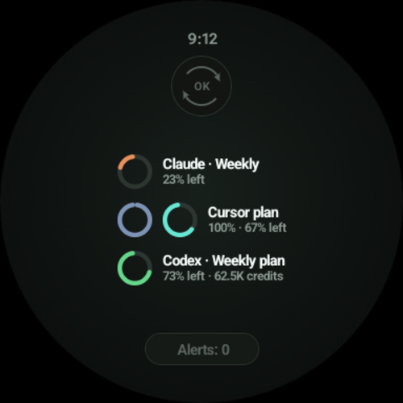
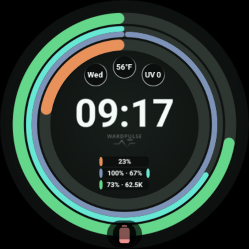

# WardPulse

See your AI plan capacity, purchased balances and API spend on Android. WardPulse brings
reporting from OpenAI, Anthropic and Cursor into one phone dashboard, with an optional
Wear OS summary, watch face and home-screen widget.

<table width="100%">
  <tr>
    <td width="50%" rowspan="2" align="center">
      
       
      <strong>Phone Dashboard</strong>
    </td>
    <td width="50%" align="center">
       
      <strong>Watch Glance</strong>
    </td>
  </tr>
  <tr>
    <td width="50%" align="center">
       
      <strong>Watch face</strong>
    </td>
  </tr>
</table>

## Start using WardPulse

Use an already-installed compatible build or one supplied by the maintainer. Sign-in and
fresh reporting need internet access. The watch face requires Wear OS 5 or later; the phone
can be used on its own. Plan connections are experimental.

- [Getting started](docs/product/user-guide/GETTING_STARTED.md)
- [Connect providers](docs/product/user-guide/PROVIDERS.md)
- [Read the Dashboard](docs/product/user-guide/DASHBOARD.md)
- [Watch and watch face](docs/product/user-guide/WATCH.md)
- [Home widget](docs/product/user-guide/WIDGET.md)
- [Sync and notifications](docs/product/user-guide/SYNC.md)
- [Settings and privacy](docs/product/user-guide/SETTINGS.md)
- [Troubleshooting](docs/product/user-guide/TROUBLESHOOTING.md)

WardPulse stores your credentials encrypted on the phone and uses them directly with their
provider. The watch receives a compact summary without credentials. There is no WardPulse
application server or developer usage telemetry. Read the [privacy policy](docs/product/PRIVACY_POLICY.md).

## License

WardPulse source code and documentation are licensed under [Apache-2.0](LICENSE) unless
otherwise stated. The license does not grant rights to the WardPulse name, logo or other
product branding; see [Trademark rules](TRADEMARKS.md).

Contributing: see the [project documentation for contributors](docs/README.md).
