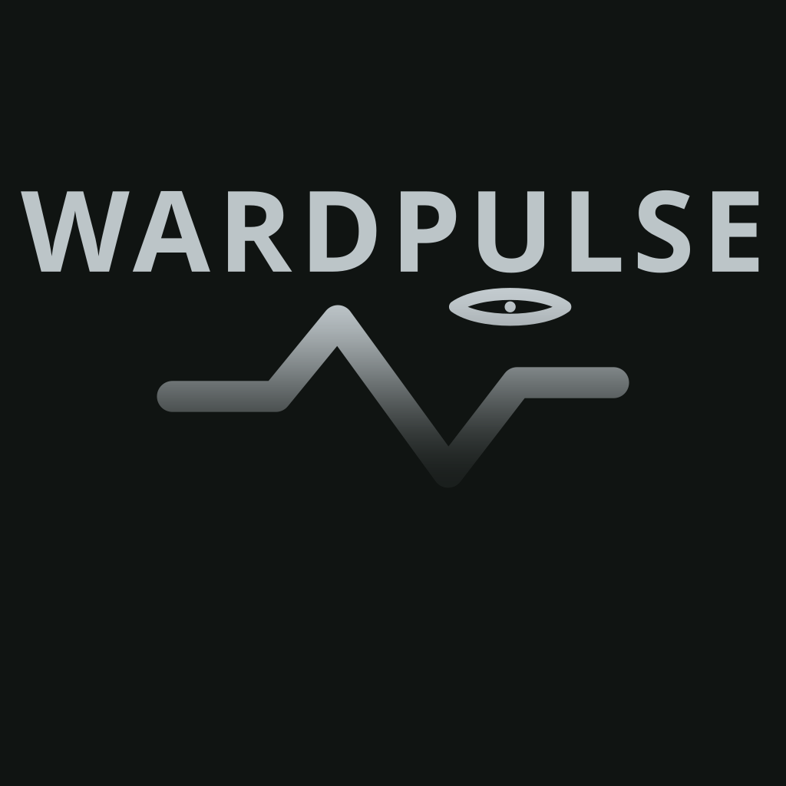

# Design Assets

WardPulse brand marks are generated from `tools/render-brand-icons.mjs`. OpenPencil
`.fig` sources remain optional for hand editing; runtime builds consume SVG/PNG exports.


Monochrome watch-face watermark (runtime PNG includes the bottom dissolve):



## Format And Viewing

For a quick visual check, open the tracked SVG or a preview PNG:

```sh
xdg-open brand/icons/wardpulse.svg
xdg-open brand/icons/previews/wardpulse-mono-on-dark.png
```

Read this Design Assets reference in the repository. The local site previews user
documentation; start that preview with:

```sh
just docs-dev
```

OpenPencil installation is optional. Use the [web app](https://app.openpencil.dev/) without
installing anything, or install a desktop build from the
[official releases](https://github.com/open-pencil/open-pencil/releases) for offline editing.
`brand/icons/wardpulse.fig` may lag the SVG generator until resynced by hand.

## Ownership

- Shared WardPulse identity sources belong in `brand/icons/`.
- Watch-face placement previews live under `brand/watchface/` (not a second SVG source).
- App-specific sources belong in a `design/` directory under the owning app
  (phone widget review art: `apps/phone_flutter/design/` — locked with
  `docs/product/PHONE_WIDGET_DESIGN.md`).
- Exported runtime assets belong in the consuming platform's normal asset or resource directory.
- Keep only locked previews under `brand/watchface/` — no scratch placement boards.

Runtime targets are `apps/phone_flutter/assets/`,
`apps/phone_flutter/android/app/src/main/res/`, `apps/wear_android/app/src/main/res/`, and
`apps/watchface_wff/src/main/res/`.

Do not create a repository-wide design system or duplicate a source file between owners. Files
under `brand/` remain outside the Apache-2.0 source license unless explicitly stated otherwise.

## Palette

- App mark body: metallic gray (`#8A9298` → `#2A3035` sheen).
- App mark framing ring (product metaphor): OpenAI/Codex `#65D78A`, Cursor `#67E8D4`,
  Anthropic `#E8915A` — three equal arcs around the metal disc.
- On-mark foreground: `#F4FBF8`.
- Watch-face watermark stroke: `#C5CDD1` (muted further by PartImage alpha + bottom fade).
- Dark surface: `#101412` (adaptive launcher background).
- Warning: `#E6C349`.

### Phone chrome (not provider colors)

Phone Material primary is gray-olive so Codex/OpenAI green and Cursor teal stay reserved for
metrics:

- Primary: `#5F675C` (light) / `#A7B09E` (dark).
- On-primary: `#F4FBF8` (light) / `#1A1F1A` (dark).
- Primary container: `#E4E7DF` (light) / `#3A4038` (dark).
- OK status pills use the same olive — not `#65D78A`.

Legacy performance teal/green (`#006B60` / `#67E8D4`) and “success = Codex green” are retired
from phone chrome. Legacy brand green (`#1F7A5A` sheen) stays out of new identity surfaces.

### Metric family accents

Used on Wear / WFF rings and on phone charts / plan bars / provider section accents
(see [product/WATCH_RING_DESIGN.md](product/WATCH_RING_DESIGN.md)):

- OpenAI / Codex: `#65D78A`; Codex · Spark: `#186020` (Spark revision 2026-09-01 — the plan's
  Spark limit is metered on its own, so it carries its own colour).
- Anthropic / Claude: `#E8915A`.
- Cursor · other models: `#67E8D4`; Cursor · own models: `#7E93B8` (split-band revision
  2026-08-13 — the two pools of one plan carry their own colours).
- Unresolved family: `#8A968F` — fallback only. A budget metric is drawn in the family color of
  the connection it belongs to, so the grey should not appear on a shipped surface.

Review exports: `tools/render-watch-ring-designs.mjs` → `round-*.svg`
(matching-provider strip may append remaining purchased credits, never LLM `TOK`;
remaining arcs melt clockwise from 12). The same generator derives one
`apps/wear_android/design/preview-*.png` face review render per entry in `variants`, mirrors
the `wffFiles` subset into `apps/watchface_wff/design/`, and rasterizes the face-picker
asset `apps/watchface_wff/src/main/res/drawable/preview.png` from the Primary one. Primary
preview: `apps/wear_android/design/preview-3-plan-credits.png`.

The [whole-composition scale, 2026-11-02](product/WATCH_RING_DESIGN.md#revision-2026-11-02--whole-composition-scale-and-paired-source-allowance)
owns current effective geometry: every reference element grows once by 225/202 about (225,225)
on the unchanged 450 canvas. Canonical resources precede review exports. All 18 textures are
sampled at ceil(reference diameter × scale), retaining reference WFF image boxes and font identity.
Boards/mirrors use one SVG composition transform, preserving measured N3 20.205/3.78 geometry and
historical ambient approximations separately from runtime nominal 20/4. The fixed local illustration
uses this same transform with disclosed historical data, not current Live or a separate 216-radius
proposal. Its metadata records reference/effective geometry, single scale and raster rounding.
New-byte native fit and paired-contour acceptance remain Pending.

The [approved active-clock translation, 2026-11-01](product/WATCH_RING_DESIGN.md#revision-2026-11-01--approved-active-clock-translation)
owns the reference centre composition beneath that scale, retaining the other
[2026-10-27 composition contracts](product/WATCH_RING_DESIGN.md#revision-2026-10-27--upward-digits-and-fixed-reference-bottoms). The
[N1-width revision](product/WATCH_RING_DESIGN.md#revision-2026-10-30--n1-width-44), retaining the
[adaptive admission contract](product/WATCH_RING_DESIGN.md#revision-2026-10-28--adaptive-bands-from-resolved-count),
owns 42 face boards/previews, 39 WFF mirrors and the shipped portrait. At adaptive-band adoption,
N3 boards, previews, portrait and the original nine textures retained their accepted bytes. Nine new
N1/N2 textures are baked at actual radii with fixed nominal 15.756 glyph caps; no existing
PNG is stretched. New one/two-band pair and D/7D/M active/ambient boards are generated
by `adaptiveVariants` in `tools/render-watch-ring-designs.mjs`. Face generation precedes
review art so the portrait reads current canonical geometry.
The 2026-10-30 N1 refit uses full 44 / half 22 at radius 180 (pair 191/169), with measured
D/7D/M counts 11/7/9 per sweep. Only the three N1 textures and affected N1 exports changed then;
N2/N3/legacy textures, unaffected art and Primary portrait retained their bytes at that revision.
The owning revision records angular envelopes, bounded count enumeration and 450/360/384 raster
spacing/clearance. These measurements do not establish independent visual or native acceptance.
Actual adaptive aperture, clipping, textures, transitions and native acceptance remain
**known Pending**. Delegated documentation/design work in the same integration owns final
healthy shared-state public captures, screenshot-index and browser review after native
acceptance; existing public images retain their dated N3 provenance.
The 52-unit cells
at (147,109)/(199,95)/(251,109) use preferred **18** with unchanged **14/12** fallbacks, centred
46×24 text at (3,14) and 24-unit icons at inset **14**. Preserve outward fading and add lower
fading only laterally.

**Active-clock revision 2026-11-01.** Adopt the Owner-approved **10-unit upward translation**:
whole-clock **86 Bold/y166**, height90, with review baseline **240.78125** (rendered **240.8**).
The earlier active **y176/250.78125** and three-row equal-gap measurements remain dated history.
Preserve **96 Thin/y175**, height90, ambient baseline **254.296875**, switching and alpha.
Generate WFF first, then all affected active boards/mirrors/PNGs and the shipped portrait;
ambient content and every texture remain unchanged. Host SVG baselines are not native ink bounds.
New-runtime native/public acceptance stays **Pending**; existing public captures retain their dates.
The original logo sits above the clock,
below the central cell, at image-box centre (225,173). Equal 132×26 wells at x159 use
120-unit labels and 20/18/16 branches with unchanged shorter-stack bottom anchoring.
The calculated bottom-corner aperture margin is 2.0730.
The 2026-10-27 revision records bounded Round calibration/corpus and twelve-case Round/Square
fit for those bytes. The [dated shared-state cohort](assets/README.md#shared-state-capture-refresh-2026-10-27)
and its scoped publication review remain accepted for their captured layout.
Generation/drift or host-font fit is not native proof.
The 2026-10-27 Source54f6 calibration measured clean active 86/y175 bottom 213 instead of 214
and true AMBIENT 97/y175 bottom 217 with height 61 on Round 384. The owning revision retains
those dated bounds/gaps and subsequent corrected Round calibration; the mixed Thin/Bold first
wake is rejected evidence despite INTERACTIVE metadata. The already delivered actual 08:08
preview creates no additional approval loop. That evidence is scoped in the dated owning revision;
unfilled temporary-time weather wells do not establish the healthy filled-default public cohort.
The historical centred calibration records six Round 384 glyph centres at **193** native pixels
(226.171875 design units) with y182, followed by the y181/70 Bold/81 Thin Source6397
candidate. Its measurements do not accept the enlarged clocks or new logo resampling.

**Historical 2026-10-25 acceptance, for those artifacts only.** Actual combined-layout
and stable-Group-name repair runs completed and were separately retired. Their legacy
WFF2 and strict Push validation/builds passed. That layout lifted clock/mark and used a
120×26 legend at 18/16/14. Round 384 active/AOD frames passed independent review;
physical 466 active Face/Glance were verified while securely unlocked and actually charging. The fresh seven-frame public
cohort has its own [capture record](assets/README.md#shared-state-capture-refresh-2026-10-25).
Independent API 34 ten-fixture/twenty-frame review passed the observed content and fit;
actual `AMBIENT` is recorded for cases 02–10, with case 01's actual-mode supplement held
before data changes. Square 360 proves only `MUTE` with NoData upper cells; true ambient,
populated Square defaults and physical AOD remain unproved. The owning revision records
these limits and state restoration; the screenshot index records completed public browser
review. Earlier bottom-only receipts do not substitute for the corrected composition.
That run's full runtime generator re-emitted the nine ring-type resources with unchanged
geometry/type inputs and byte-identical results. The shared preview helper retains its
Glance caller contract; unrelated Glance, brand and widget exports were not regenerated by
that face run. The combined integration preserves Main's admitted Glance artwork and newer
27/23 clock-free generator. A separate HOST verification ran the unchanged runtime-face,
face-review and Glance-review generators to normal exit 0 in a task-owned throwaway
checkout: all 136 SVG/PNG/XML/texture outputs matched Main byte for byte, without writing
canonical exports. This proved correspondence for those historical bytes, separately from
native fit and screenshot freshness; it does not verify the 2026-10-27 outputs.

Wear **app** Glance legend (**baseline locked 2026-07-26**, not the face):
`tools/render-wear-glance-designs.mjs` → `glance-legend-*.svg` /
`preview-glance-legend-*.png`. Primary preview:
`apps/wear_android/design/preview-glance-legend-3.png`. Variants: `3`, `1`, `pair`, `budget`,
`stale`, `cadence`, `rate-limit`, `empty`, `exhausted`.
See [`product/WEAR_GLANCE_DESIGN.md`](product/WEAR_GLANCE_DESIGN.md).

Family colors are for metric identity, not buttons, nav, or filled chrome.
**Exception:** the official app logo framing ring intentionally echoes those three families as a
product metaphor. Do not spread that tri-color chrome into buttons, cards, or other UI.

## Mark

The metal disc reads as a monitoring instrument. The framing ring ties the product to the watch
ring language. The pulse communicates activity and throughput. The small eye signals watchful,
local monitoring — keep it in the upper-right of the mark and preserve its scale relative to the
pulse.

Use the **color metal+ring** mark for the phone app bar and phone / Wear launchers. Its opaque
metal disc keeps the compact app-bar mark distinct in both themes; reserve the ringless mono
wordmark for quiet watermark treatments.

### Watch-face watermark (locked)

Quiet branding on WFF — not a second hero. Locked with the concentric face baseline:

- **Whole-composition scale, 2026-11-02** — the original image boxes below are reference
  geometry under the common 225/202 carrier. The portrait derives their effective bounds from
  canonical XML, rounds each raster edge once and records nominal plus rounded bounds; the active
  overlay is (189,131,72,72). The original source pixels/alpha/fade and runtime alpha95/70 stay fixed.
- **No framing ring** — straight `WARDPULSE` wordmark above the pulse + eye.
- **Placement** — below the central upper cell and above the enlarged whole clock; order is
  cells → logo → clock → sunk strips.
- **Size / mute, revision 2026-10-27** — active **64×64 at (193,141)** on the 450 canvas,
  alpha **95** (37%); ambient **54×54 at (198,146)**, alpha **70**. Both image-box
  centres are **(225,173)**. Keep the original square 192×192 source and alpha pixels,
  SHA-256 `599a722e2c08bb5d952e87ceb0ea02c228c77554e0dc3572e7eeb992b96d1cef`,
  in both runtime/widget copies; no extra shading, darkening, fade, blur or mask.
  Source alpha bounds x[4,186), y[46,120) map to active ink
  **x[194.333333…,255), y[156.333333…,181)**. Ambient ink is exactly
  **x[199.125,250.3125), y[158.9375,179.75)**, retaining source-padding asymmetry.
  Calculated central/left/right well clearances are **9.333333 /4.169889 /4.644920 active**
  and **11.9375 /9.433311 /9.850057 ambient**. Target visible logo→08:08 and 08:08→legend
  gaps in the three-row reference are **8.21875 active /4.703125 ambient**. These are affine
  bounds and reference intent, not measured composited-logo ink/opacity. The owning Round
  glyph-gap record uses this source-alpha boundary; unobserved native scope stays Pending.
  Historical centred 2026-10-27 boxes were 62 at (194,142) and 52 at (199,147),
  with ink bottoms **180.75/179.5** and nominal clock y181; these are superseded.
  **Historical 2026-10-25:** active 66-square (192,214) / ambient 54-square (198,220) mapped
  ink to y229.8125–255.25 / 232.9375–253.75, leaving 3.75/5.25 before row259. Earlier boxes
  (192,227)/(198,233), ink ending near268 and rows271/283 likewise describe dated layouts.
- **Bottom dissolve** — preserve the original content-relative fade
  (`tools/fade-watermark-png.py` during `just export-icons`); moving/resizing the box adds
  no new fade. The pulse remains quiet beside the time and metrics.
- Eye placement matches the color mark; pupil stays inside the almond rim.
- **Phone home widget** reuses the same faded mono PNG (`wardpulse_mono`), tinted for
  day/night olive chrome. The 2026-11-01 renderer crops only transparent margins before
  placing the quiet overlay at the frame edge, clear of the complete content. The widget
  review generator owns its SVG/PNG illustrations and light/dark picker rasters/layout;
  those use the exact Android-bundled Noto fonts and do not replace native captures.

Canonical preview: `apps/watchface_wff/src/main/res/drawable/preview.png`, the face's own
shipped portrait, generated.

**Preview revision 2026-10-11 — the placement preview is generated, not captured.** That image
had been written once, on 2026-07-25, and never again. Looked at on 2026-10-11 it showed a face
the product had left behind: no upper cells, which the face locked on 2026-10-09, and a legend
stack from before the current treatment. So this section was making a placement claim —
*between time and sunk strips* — against a canvas that no longer had the thing above it.

Its signature says it came from a render of the real face: the watermark is in it, and no review
board draws one. A fresh capture was therefore available and was weighed against generating the
picture. **Generating wins, and the reason is reproducibility.** A capture carries whatever the
device held at that moment — on `emulator-5554` the same day, the system picker's own render
showed one set of cell values and the running face another, with two empty wells because weather
was unavailable there. An asset whose content depends on which surface was photographed, and
when, is not canonical. And a capture is a step somebody has to remember, which is the defect
this revision exists to end, not a way to end it.

It was composed by `just export-icons` from two parts that are themselves generated: the
face-picker asset `apps/watchface_wff/src/main/res/drawable/preview.png` and the faded mono
drawable beside it. The box comes from `watchface.xml`, **read from that file at render time
rather than copied here**, so the preview cannot disagree with the face about where the mark
sits — when the face moves it, the preview moves with it, and the numbers in the bullet above
are checked against the same source. The canvas is the face's own 450 units, down from the
previous 675, so every coordinate in this section measures 1:1 against the picture. Where that
picture now lives is the next block.

What this buys and what it costs: the picture is reproducible and tied to the face's own
numbers, and it reconstructs the placement instead of witnessing it. WFF's own compositing —
how the mark actually blends on the watch — is not proved here and is not what this section
cites the preview for; that is a device capture, by hand (`docs/ANDROID_TOOLCHAIN.md`).

The revision set one condition on itself: *the picker asset does not currently draw the
watermark the face draws; if that is ever corrected, this composite becomes a duplicate of it,
and the right move is for this document to cite the face's own asset and stop keeping a brand
copy at all.*

**The condition fired the same day.** `docs/product/WATCH_RING_DESIGN.md` ruled on 2026-10-11
that the face's shipped portrait carries the mark the face carries — a portrait that drops a
locked element of the face shows a wearer a face they will not get — so
`apps/watchface_wff/src/main/res/drawable/preview.png` is now composed from the Primary board
and this same faded mono drawable, in this same box. That makes it the picture
`brand/watchface/preview-face-active-quiet.png` was, so the brand copy is **retired**: the file
is deleted, the compositing step is gone from `tools/export-icons.sh`, and this document cites
the face's asset above. One canonical picture, owned by the document that owns the face.

Two things survive the move and are this document's, not the baseline's. The current active
**box** — 64×64 at (193,141), alpha95 under the 2026-10-27 revision — is read out of
`watchface.xml` at render time rather than copied into a generator, so the portrait cannot
drift from the placement it documents. And the mark in it is still WardPulse branding:
compositing it into a shipped drawable no more places it under
Apache-2.0 than bundling the app-bar copies does.

The ordering between the two generators reverses with the move. `just export-icons` no longer
reads the picker asset; `just render-designs` now reads the faded mono drawable this script
writes. So a change to the **mark** runs `just export-icons` first and then
`just render-designs`, which is the opposite of what this revision first required.

## Source And Runtime Files

| Role | Path |
|------|------|
| Color logo (canonical SVG) | `brand/icons/wardpulse.svg` |
| Mono watermark (canonical SVG) | `brand/icons/wardpulse-mono.svg` |
| PNG previews (incl. faded mono) | `brand/icons/previews/` |
| Flutter app-bar mark (1× / 2× / 3× PNG) | `apps/phone_flutter/assets/brand/` |
| Phone / Wear launcher mipmaps | `mipmap-*/ic_launcher.png` |
| Phone adaptive foreground | `drawable-*/ic_launcher_foreground.png` |
| WFF runtime mono (faded PNG) | `apps/watchface_wff/src/main/res/drawable/wardpulse_mono.png` |
| Phone widget mono (same faded PNG) | `apps/phone_flutter/android/app/src/main/res/drawable/wardpulse_mono.png` |
| WFF face-picker preview | `apps/watchface_wff/src/main/res/drawable/preview.png` |
| WFF ring type, one per ring and period | `apps/watchface_wff/src/main/res/drawable-nodpi/ring{1,2,3}_type_{day,week,month}.png` |

Prefer regenerating exports with `just export-icons` rather than editing PNGs by hand. The mono
drawable must go through `tools/fade-watermark-png.py` (wired in `tools/export-icons.sh`).
Commit runtime exports when an application build consumes them.

The Flutter app-bar copies are bundled WardPulse branding. Moving them into the APK does not
place them under Apache-2.0 or grant downstream use of the WardPulse mark.

The last two rows are the exception: neither is a brand export. The face-picker preview is the
face's own shipped portrait, drawn from the Primary board by `tools/render-watch-ring-designs.mjs`
(`just render-designs`) with the faded mono drawable composed into it at the box above, and
named by `apps/watchface_wff/src/main/res/xml/watch_face_info.xml`; the ring type is the face's
own type, baked by `tools/render-watchface.mjs` (`just render-watchface`) alongside the XML that
names it. Regenerate each there. The mark inside the portrait stays brand: a composite is not a
licence.

ImageMagick is required; Inkscape is preferred for mono SVG→PNG when available.
`tools/fade-watermark-png.py` needs Pillow (`pip`/`apt` package `python3-pil`).
`tools/render-watch-ring-designs.mjs` and `tools/render-wear-glance-designs.mjs` need it too,
plus the Noto Sans Bold file they measure labels against: they stop on a missing font rather
than guess a width, so committed art never depends on the machine that rendered it.

## Setup

The repository pins the OpenPencil CLI as an npm development dependency for optional `.fig`
workflows. Install with the existing workspace toolchain:

```sh
npm ci
```

## Export

Regenerate SVGs, previews, launcher PNGs, and the faded watch-face mono drawable:

```sh
just export-icons
just render-designs   # only after a mark change — composes the mono drawable into the portrait
```

The order matters in that one case: the face's shipped portrait is composed on top of the faded
mono drawable, so a change to the **mark** has to reach that drawable before the design
generator reads it. For a change to the **face**, run `node tools/render-watchface.mjs`
before `node tools/render-watch-ring-designs.mjs`: the portrait reads its active logo box
from the generated XML. Neither command needs a brand export when the mark is unchanged.

Do **not** run `just export-design brand/icons/wardpulse.fig …` until the `.fig` is resynced
to the metal+ring mark — an old `.fig` would overwrite the canonical SVG.
